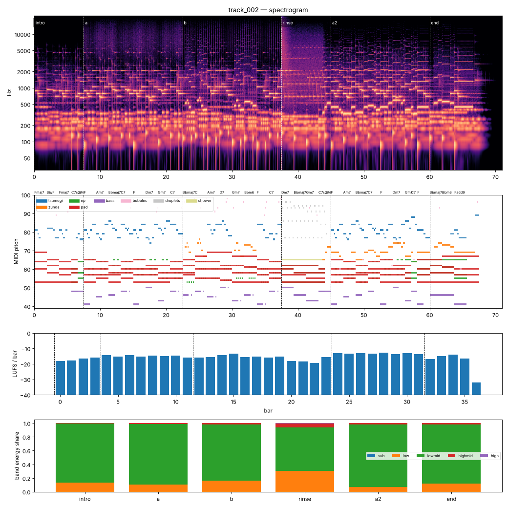

# Render report — track_002_v001

- song: `track_002` | key F major | 96 BPM | 6 sections | 71.0s
- git: `4aa38fa772` (dirty) | spec hash `8bf72181e7c94546` | seed 2002

## Layer 1 — rule checks
- **INFO** `motif.ok` Motifs repeated+transformed: ['awa', 'nanoda'] (uses: {'awa': 11, 'nanoda': 2}) _melody_

## Layer 2 — acoustic diagnostics (not a quality score)

| metric | value |
|---|---|
| lufs_integrated | -15.00 |
| true_peak_dbtp | -2.56 |
| peak_dbfs | -2.57 |
| rms_dbfs | -17.93 |
| crest_db | 15.36 |
| side_to_mid_db | -13.89 |
| lr_correlation | 0.92 |
| master gain into limiter (dB) | -2.10 |
| limiter max gain reduction (dB) | -0.00 |

### Sections

| section | energy tgt | LUFS | centroid Hz | rolloff Hz | onsets/s | side/mid dB | side/mid >300 Hz | sub | low | lowmid | highmid | high |
|---|---|---|---|---|---|---|---|---|---|---|---|---|
| intro | 0.25 | -17.1 | 804 | 1135 | 1.7 | -10.5 | -13.2 | 0.000 | 0.135 | 0.862 | 0.003 | 0.000 |
| a | 0.5 | -15.0 | 1464 | 2170 | 2.8 | -15.2 | -16.6 | 0.000 | 0.107 | 0.882 | 0.010 | 0.000 |
| b | 0.55 | -15.2 | 1228 | 2010 | 3.0 | -15.4 | -16.0 | 0.000 | 0.164 | 0.818 | 0.017 | 0.000 |
| rinse | 0.4 | -17.6 | 1978 | 3684 | 2.1 | -10.6 | -12.3 | 0.000 | 0.303 | 0.638 | 0.055 | 0.004 |
| a2 | 0.6 | -13.2 | 1092 | 1793 | 2.5 | -15.6 | -16.7 | 0.000 | 0.070 | 0.911 | 0.019 | 0.000 |
| end | 0.3 | -15.2 | 1015 | 1680 | 1.1 | -11.3 | -14.0 | 0.000 | 0.122 | 0.856 | 0.022 | 0.000 |

### Section contrast
- intro → a: ΔLUFS 2.1, Δcentroid 660 Hz, Δonsets/s 1.1, Δwidth -4.7 dB (>300 Hz: -3.5 dB)
- a → b: ΔLUFS -0.2, Δcentroid -236 Hz, Δonsets/s 0.2, Δwidth -0.2 dB (>300 Hz: 0.6 dB)
- b → rinse: ΔLUFS -2.4, Δcentroid 750 Hz, Δonsets/s -0.9, Δwidth 4.8 dB (>300 Hz: 3.7 dB)
- rinse → a2: ΔLUFS 4.4, Δcentroid -886 Hz, Δonsets/s 0.3, Δwidth -4.9 dB (>300 Hz: -4.5 dB)
- a2 → end: ΔLUFS -2.0, Δcentroid -78 Hz, Δonsets/s -1.4, Δwidth 4.3 dB (>300 Hz: 2.8 dB)

### Loudness by bar (LUFS)

0:-18 1:-18 2:-17 3:-16 4:-14 5:-15 6:-14 7:-15 8:-15 9:-15 10:-15 11:-16 12:-16 13:-15 14:-14 15:-13 16:-16 17:-15 18:-16 19:-15 20:-18 21:-19 22:-20 23:-16 24:-13 25:-13 26:-13 27:-13 28:-13 29:-14 30:-13 31:-14 32:-17 33:-15 34:-14 35:-17 36:-32 37:–

### Stem diagnostics
- lead_presence: lead_to_rest_1k5k_db=29.061, active_fraction=0.734
- low_end_stereo: side_to_mid_db=-15.798, lr_correlation=0.949

### Tonality
- declared: F major (rank 2); estimate: A minor (0.84), F major (0.81), C major (0.72)

## Layer 3 / 4
Critic reviews go to `critiques/`, human A/B choices to `feedback/preferences.jsonl`.

