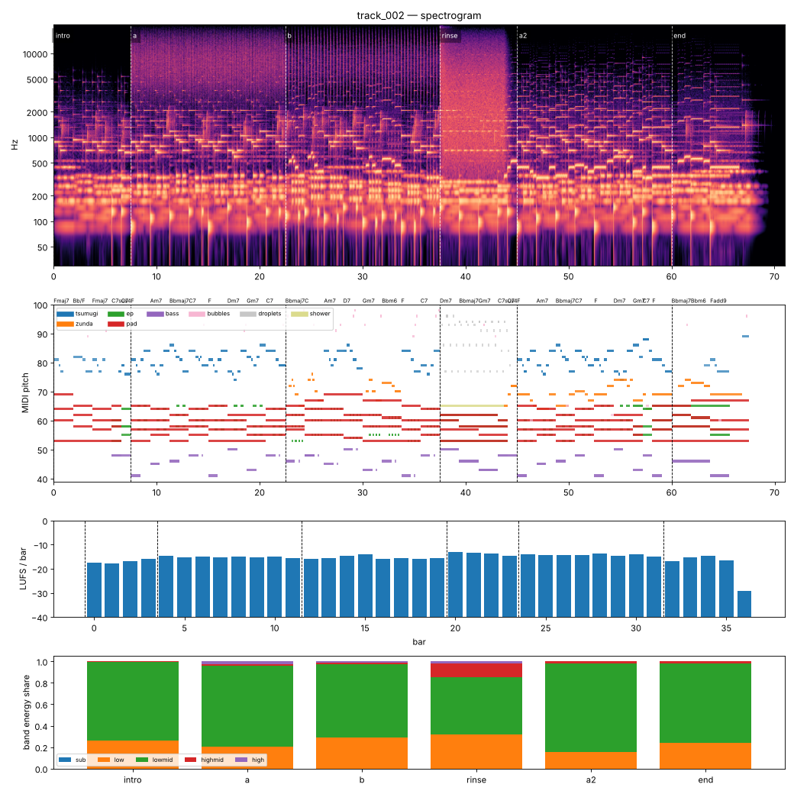

# Render report — track_002_v002

- song: `track_002` | key F major | 96 BPM | 6 sections | 71.0s
- git: `4aa38fa772` (dirty) | spec hash `58c288ce6a77546b` | seed 2002

## Layer 1 — rule checks
- **INFO** `motif.ok` Motifs repeated+transformed: ['awa', 'nanoda'] (uses: {'awa': 11, 'nanoda': 2}) _melody_

## Layer 2 — acoustic diagnostics (not a quality score)

| metric | value |
|---|---|
| lufs_integrated | -15.00 |
| true_peak_dbtp | -1.04 |
| peak_dbfs | -1.06 |
| rms_dbfs | -18.02 |
| crest_db | 16.95 |
| side_to_mid_db | -9.88 |
| lr_correlation | 0.81 |
| master gain into limiter (dB) | -3.62 |
| limiter max gain reduction (dB) | 0.06 |

### Sections

| section | energy tgt | LUFS | centroid Hz | rolloff Hz | onsets/s | side/mid dB | side/mid >300 Hz | sub | low | lowmid | highmid | high |
|---|---|---|---|---|---|---|---|---|---|---|---|---|
| intro | 0.25 | -16.9 | 739 | 1126 | 2.4 | -7.5 | -9.6 | 0.000 | 0.265 | 0.730 | 0.005 | 0.000 |
| a | 0.5 | -15.2 | 4049 | 8488 | 5.7 | -12.5 | -13.8 | 0.000 | 0.202 | 0.755 | 0.017 | 0.026 |
| b | 0.55 | -15.4 | 2656 | 5377 | 3.1 | -12.8 | -12.7 | 0.000 | 0.291 | 0.680 | 0.016 | 0.013 |
| rinse | 0.4 | -13.6 | 3466 | 6809 | 0.8 | -3.9 | -2.5 | 0.000 | 0.320 | 0.530 | 0.128 | 0.022 |
| a2 | 0.6 | -14.2 | 1027 | 1739 | 2.5 | -13.6 | -15.8 | 0.000 | 0.157 | 0.824 | 0.018 | 0.000 |
| end | 0.3 | -15.5 | 869 | 1481 | 1.3 | -8.4 | -11.2 | 0.000 | 0.243 | 0.741 | 0.016 | 0.000 |

### Section contrast
- intro → a: ΔLUFS 1.7, Δcentroid 3310 Hz, Δonsets/s 3.3, Δwidth -5.0 dB (>300 Hz: -4.2 dB)
- a → b: ΔLUFS -0.2, Δcentroid -1393 Hz, Δonsets/s -2.5, Δwidth -0.3 dB (>300 Hz: 1.2 dB)
- b → rinse: ΔLUFS 1.8, Δcentroid 810 Hz, Δonsets/s -2.3, Δwidth 8.9 dB (>300 Hz: 10.2 dB)
- rinse → a2: ΔLUFS -0.7, Δcentroid -2439 Hz, Δonsets/s 1.7, Δwidth -9.7 dB (>300 Hz: -13.3 dB)
- a2 → end: ΔLUFS -1.3, Δcentroid -158 Hz, Δonsets/s -1.1, Δwidth 5.1 dB (>300 Hz: 4.6 dB)

### Loudness by bar (LUFS)

0:-18 1:-18 2:-17 3:-16 4:-15 5:-15 6:-15 7:-15 8:-15 9:-15 10:-15 11:-16 12:-16 13:-16 14:-15 15:-14 16:-16 17:-16 18:-16 19:-16 20:-13 21:-13 22:-14 23:-15 24:-14 25:-14 26:-14 27:-14 28:-14 29:-15 30:-14 31:-15 32:-17 33:-15 34:-15 35:-16 36:-29 37:–

### Stem diagnostics
- lead_presence: lead_to_rest_1k5k_db=20.382, active_fraction=0.734
- low_end_stereo: side_to_mid_db=-14.537, lr_correlation=0.932

### Tonality
- declared: F major (rank 2); estimate: A minor (0.83), F major (0.83), C major (0.72)

## Layer 3 / 4
Critic reviews go to `critiques/`, human A/B choices to `feedback/preferences.jsonl`.

