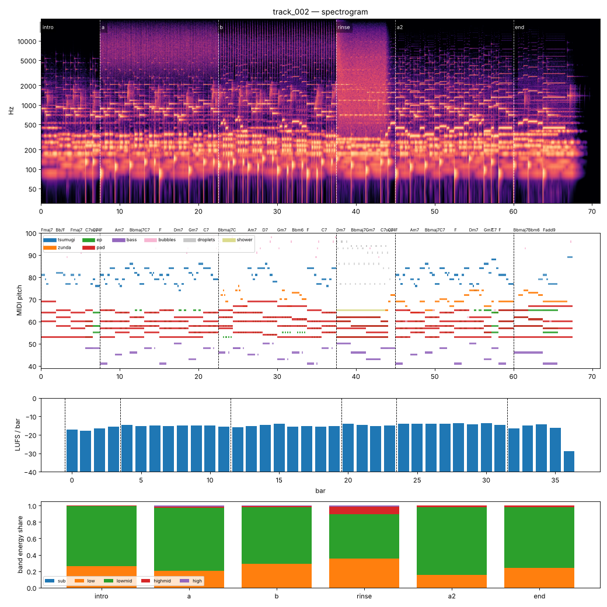

# Render report — track_002_v003

- song: `track_002` | key F major | 96 BPM | 6 sections | 71.0s
- git: `4aa38fa772` (dirty) | spec hash `b3b46aa34a971022` | seed 2002

## Layer 1 — rule checks
- **INFO** `motif.ok` Motifs repeated+transformed: ['awa', 'nanoda'] (uses: {'awa': 11, 'nanoda': 2}) _melody_

## Layer 2 — acoustic diagnostics (not a quality score)

| metric | value |
|---|---|
| lufs_integrated | -15.00 |
| true_peak_dbtp | -1.04 |
| peak_dbfs | -1.05 |
| rms_dbfs | -17.91 |
| crest_db | 16.86 |
| side_to_mid_db | -10.62 |
| lr_correlation | 0.84 |
| master gain into limiter (dB) | -3.41 |
| limiter max gain reduction (dB) | 0.27 |

### Sections

| section | energy tgt | LUFS | centroid Hz | rolloff Hz | onsets/s | side/mid dB | side/mid >300 Hz | sub | low | lowmid | highmid | high |
|---|---|---|---|---|---|---|---|---|---|---|---|---|
| intro | 0.25 | -16.7 | 739 | 1126 | 2.4 | -7.5 | -9.6 | 0.000 | 0.265 | 0.730 | 0.005 | 0.000 |
| a | 0.5 | -15.2 | 3483 | 7531 | 5.3 | -12.7 | -14.2 | 0.000 | 0.206 | 0.766 | 0.014 | 0.013 |
| b | 0.55 | -15.2 | 2300 | 4777 | 3.2 | -12.9 | -12.9 | 0.000 | 0.293 | 0.685 | 0.015 | 0.006 |
| rinse | 0.4 | -14.6 | 3179 | 6383 | 1.3 | -6.0 | -5.0 | 0.000 | 0.354 | 0.543 | 0.087 | 0.015 |
| a2 | 0.6 | -14.0 | 1027 | 1739 | 2.5 | -13.6 | -15.8 | 0.000 | 0.157 | 0.824 | 0.018 | 0.000 |
| end | 0.3 | -15.3 | 869 | 1481 | 1.3 | -8.4 | -11.2 | 0.000 | 0.243 | 0.741 | 0.016 | 0.000 |

### Section contrast
- intro → a: ΔLUFS 1.6, Δcentroid 2744 Hz, Δonsets/s 2.9, Δwidth -5.2 dB (>300 Hz: -4.6 dB)
- a → b: ΔLUFS -0.1, Δcentroid -1183 Hz, Δonsets/s -2.1, Δwidth -0.2 dB (>300 Hz: 1.4 dB)
- b → rinse: ΔLUFS 0.7, Δcentroid 879 Hz, Δonsets/s -1.9, Δwidth 6.9 dB (>300 Hz: 7.9 dB)
- rinse → a2: ΔLUFS 0.6, Δcentroid -2152 Hz, Δonsets/s 1.1, Δwidth -7.6 dB (>300 Hz: -10.8 dB)
- a2 → end: ΔLUFS -1.3, Δcentroid -158 Hz, Δonsets/s -1.1, Δwidth 5.1 dB (>300 Hz: 4.6 dB)

### Loudness by bar (LUFS)

0:-17 1:-18 2:-17 3:-16 4:-15 5:-15 6:-15 7:-15 8:-15 9:-15 10:-15 11:-15 12:-16 13:-15 14:-15 15:-14 16:-16 17:-15 18:-16 19:-15 20:-14 21:-15 22:-15 23:-15 24:-14 25:-14 26:-14 27:-14 28:-14 29:-14 30:-14 31:-15 32:-17 33:-15 34:-14 35:-16 36:-29 37:–

### Stem diagnostics
- lead_presence: lead_to_rest_1k5k_db=21.092, active_fraction=0.734
- low_end_stereo: side_to_mid_db=-14.538, lr_correlation=0.932

### Tonality
- declared: F major (rank 2); estimate: A minor (0.83), F major (0.83), C major (0.72)

## Layer 3 / 4
Critic reviews go to `critiques/`, human A/B choices to `feedback/preferences.jsonl`.

