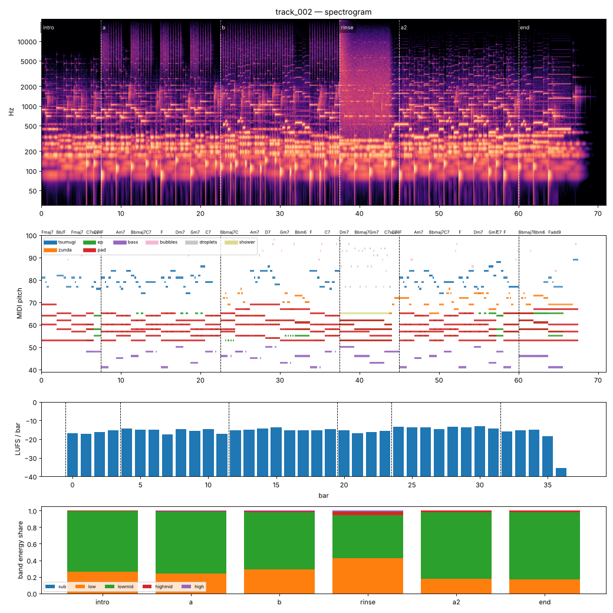

# Render report — track_002_v004

- song: `track_002` | key F major | 96 BPM | 6 sections | 71.0s
- git: `3f09b35537` (dirty) | spec hash `9ffae5257f0805c4` | seed 2002

## Layer 1 — rule checks
- **INFO** `motif.ok` Motifs repeated+transformed: ['awa', 'nanoda'] (uses: {'awa': 10, 'nanoda': 4}) _melody_

## Layer 2 — acoustic diagnostics (not a quality score)

| metric | value |
|---|---|
| lufs_integrated | -15.00 |
| true_peak_dbtp | -1.67 |
| peak_dbfs | -1.72 |
| rms_dbfs | -17.81 |
| crest_db | 16.09 |
| side_to_mid_db | -11.19 |
| lr_correlation | 0.86 |
| master gain into limiter (dB) | -2.94 |
| limiter max gain reduction (dB) | -0.00 |

### Sections

| section | energy tgt | LUFS | centroid Hz | rolloff Hz | onsets/s | side/mid dB | side/mid >300 Hz | sub | low | lowmid | highmid | high |
|---|---|---|---|---|---|---|---|---|---|---|---|---|
| intro | 0.25 | -16.3 | 739 | 1126 | 2.4 | -7.5 | -9.6 | 0.000 | 0.265 | 0.730 | 0.005 | 0.000 |
| a | 0.5 | -15.4 | 1831 | 3687 | 3.8 | -12.5 | -14.3 | 0.000 | 0.240 | 0.747 | 0.010 | 0.003 |
| b | 0.55 | -14.8 | 1698 | 3471 | 3.1 | -12.6 | -12.8 | 0.000 | 0.291 | 0.691 | 0.015 | 0.002 |
| rinse | 0.4 | -15.7 | 2503 | 5001 | 1.7 | -7.3 | -6.9 | 0.000 | 0.426 | 0.516 | 0.047 | 0.011 |
| a2 | 0.6 | -13.7 | 1008 | 1708 | 2.7 | -12.7 | -15.0 | 0.000 | 0.178 | 0.805 | 0.016 | 0.000 |
| end | 0.3 | -15.9 | 946 | 1604 | 1.7 | -11.9 | -13.7 | 0.000 | 0.170 | 0.810 | 0.019 | 0.000 |

### Section contrast
- intro → a: ΔLUFS 0.9, Δcentroid 1092 Hz, Δonsets/s 1.4, Δwidth -5.0 dB (>300 Hz: -4.6 dB)
- a → b: ΔLUFS 0.5, Δcentroid -133 Hz, Δonsets/s -0.7, Δwidth -0.1 dB (>300 Hz: 1.5 dB)
- b → rinse: ΔLUFS -0.9, Δcentroid 806 Hz, Δonsets/s -1.3, Δwidth 5.3 dB (>300 Hz: 5.9 dB)
- rinse → a2: ΔLUFS 2.0, Δcentroid -1495 Hz, Δonsets/s 0.9, Δwidth -5.3 dB (>300 Hz: -8.1 dB)
- a2 → end: ΔLUFS -2.2, Δcentroid -62 Hz, Δonsets/s -0.9, Δwidth 0.8 dB (>300 Hz: 1.3 dB)

### Loudness by bar (LUFS)

0:-17 1:-17 2:-16 3:-15 4:-14 5:-15 6:-15 7:-17 8:-15 9:-16 10:-15 11:-17 12:-15 13:-15 14:-14 15:-14 16:-15 17:-15 18:-15 19:-15 20:-15 21:-17 22:-16 23:-16 24:-13 25:-14 26:-14 27:-15 28:-13 29:-14 30:-13 31:-14 32:-16 33:-15 34:-15 35:-18 36:-35 37:-70

### Stem diagnostics
- lead_presence: lead_to_rest_1k5k_db=22.760, active_fraction=0.682
- low_end_stereo: side_to_mid_db=-14.976, lr_correlation=0.938

### Tonality
- declared: F major (rank 1); estimate: F major (0.83), A minor (0.82), C major (0.75)

## Layer 3 / 4
Critic reviews go to `critiques/`, human A/B choices to `feedback/preferences.jsonl`.

