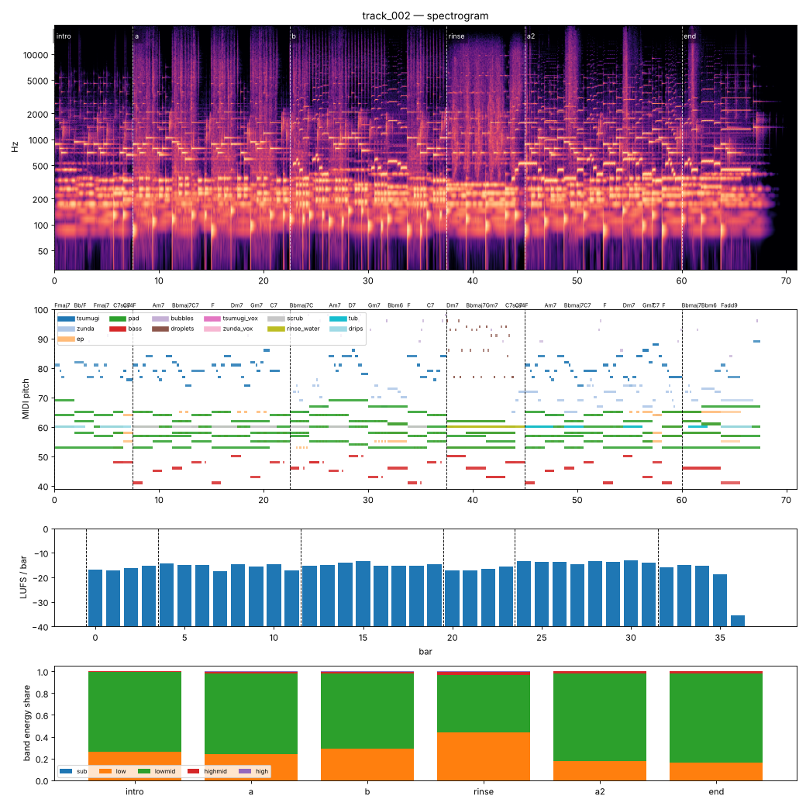

# Render report — track_002_v006

- song: `track_002` | key F major | 96 BPM | 6 sections | 71.0s
- git: `93c97de82f` (dirty) | spec hash `42ee9dda964da819` | seed 2002

## Layer 1 — rule checks
- **INFO** `motif.ok` Motifs repeated+transformed: ['awa', 'nanoda'] (uses: {'awa': 10, 'nanoda': 3}) _melody_

## Layer 2 — acoustic diagnostics (not a quality score)

| metric | value |
|---|---|
| lufs_integrated | -15.00 |
| true_peak_dbtp | -1.73 |
| peak_dbfs | -1.76 |
| rms_dbfs | -17.79 |
| crest_db | 16.03 |
| side_to_mid_db | -11.52 |
| lr_correlation | 0.87 |
| master gain into limiter (dB) | -2.90 |
| limiter max gain reduction (dB) | -0.00 |

### Sections

| section | energy tgt | LUFS | centroid Hz | rolloff Hz | onsets/s | side/mid dB | side/mid >300 Hz | sub | low | lowmid | highmid | high |
|---|---|---|---|---|---|---|---|---|---|---|---|---|
| intro | 0.25 | -16.2 | 843 | 1258 | 2.5 | -7.5 | -9.6 | 0.000 | 0.265 | 0.730 | 0.006 | 0.000 |
| a | 0.5 | -15.3 | 2068 | 4301 | 3.3 | -12.6 | -14.3 | 0.000 | 0.241 | 0.741 | 0.014 | 0.003 |
| b | 0.55 | -14.8 | 1696 | 3442 | 3.5 | -12.6 | -12.8 | 0.000 | 0.292 | 0.691 | 0.015 | 0.002 |
| rinse | 0.4 | -16.3 | 2117 | 4559 | 2.9 | -9.2 | -11.7 | 0.000 | 0.437 | 0.527 | 0.033 | 0.003 |
| a2 | 0.6 | -13.6 | 1390 | 2581 | 3.1 | -12.7 | -15.1 | 0.000 | 0.176 | 0.805 | 0.017 | 0.001 |
| end | 0.3 | -15.9 | 1284 | 2287 | 1.9 | -11.7 | -13.6 | 0.000 | 0.160 | 0.819 | 0.019 | 0.001 |

### Section contrast
- intro → a: ΔLUFS 0.9, Δcentroid 1226 Hz, Δonsets/s 0.7, Δwidth -5.1 dB (>300 Hz: -4.7 dB)
- a → b: ΔLUFS 0.5, Δcentroid -372 Hz, Δonsets/s 0.3, Δwidth -0.1 dB (>300 Hz: 1.5 dB)
- b → rinse: ΔLUFS -1.5, Δcentroid 421 Hz, Δonsets/s -0.6, Δwidth 3.4 dB (>300 Hz: 1.1 dB)
- rinse → a2: ΔLUFS 2.6, Δcentroid -727 Hz, Δonsets/s 0.2, Δwidth -3.5 dB (>300 Hz: -3.4 dB)
- a2 → end: ΔLUFS -2.3, Δcentroid -106 Hz, Δonsets/s -1.3, Δwidth 1.0 dB (>300 Hz: 1.5 dB)

### Loudness by bar (LUFS)

0:-17 1:-17 2:-16 3:-15 4:-14 5:-15 6:-15 7:-17 8:-15 9:-15 10:-15 11:-17 12:-15 13:-15 14:-14 15:-14 16:-15 17:-15 18:-15 19:-15 20:-17 21:-17 22:-17 23:-16 24:-13 25:-14 26:-14 27:-15 28:-13 29:-14 30:-13 31:-14 32:-16 33:-15 34:-15 35:-19 36:-35 37:-70

### Stem diagnostics
- lead_presence: lead_to_rest_1k5k_db=19.025, active_fraction=0.682
- low_end_stereo: side_to_mid_db=-14.948, lr_correlation=0.938

### Tonality
- declared: F major (rank 1); estimate: F major (0.84), A minor (0.82), C major (0.75)

## Layer 3 / 4
Critic reviews go to `critiques/`, human A/B choices to `feedback/preferences.jsonl`.

