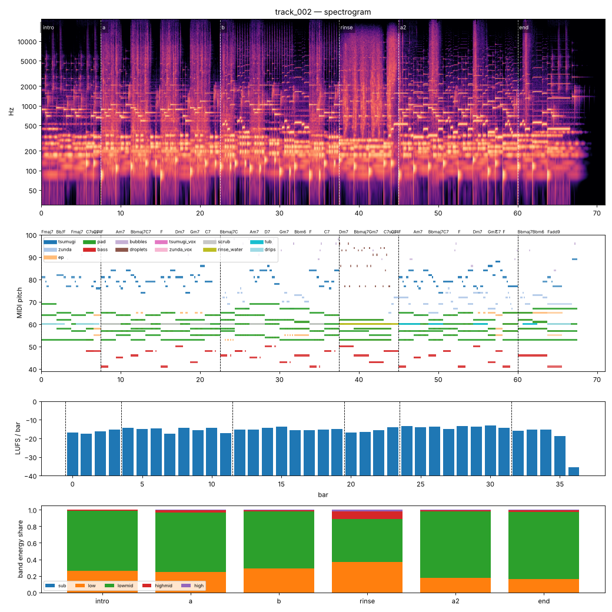

# Render report — track_002_v007

- song: `track_002` | key F major | 96 BPM | 6 sections | 71.0s
- git: `93c97de82f` (dirty) | spec hash `37b7f744bd12a7dc` | seed 2002

## Layer 1 — rule checks
- **INFO** `motif.ok` Motifs repeated+transformed: ['awa', 'nanoda'] (uses: {'awa': 10, 'nanoda': 3}) _melody_

## Layer 2 — acoustic diagnostics (not a quality score)

| metric | value |
|---|---|
| lufs_integrated | -15.02 |
| true_peak_dbtp | -1.04 |
| peak_dbfs | -1.05 |
| rms_dbfs | -17.89 |
| crest_db | 16.84 |
| side_to_mid_db | -11.63 |
| lr_correlation | 0.87 |
| master gain into limiter (dB) | -3.11 |
| limiter max gain reduction (dB) | 2.72 |

### Sections

| section | energy tgt | LUFS | centroid Hz | rolloff Hz | onsets/s | side/mid dB | side/mid >300 Hz | sub | low | lowmid | highmid | high |
|---|---|---|---|---|---|---|---|---|---|---|---|---|
| intro | 0.25 | -16.4 | 1093 | 1701 | 3.2 | -7.5 | -9.6 | 0.000 | 0.263 | 0.726 | 0.010 | 0.000 |
| a | 0.5 | -15.2 | 2346 | 4870 | 3.1 | -12.7 | -14.4 | 0.000 | 0.247 | 0.719 | 0.027 | 0.006 |
| b | 0.55 | -14.9 | 1839 | 3776 | 3.5 | -12.6 | -12.8 | 0.000 | 0.293 | 0.686 | 0.018 | 0.002 |
| rinse | 0.4 | -15.4 | 3139 | 6665 | 3.1 | -10.0 | -13.1 | 0.000 | 0.366 | 0.523 | 0.089 | 0.022 |
| a2 | 0.6 | -13.8 | 1592 | 2940 | 2.7 | -12.8 | -15.1 | 0.000 | 0.175 | 0.802 | 0.020 | 0.003 |
| end | 0.3 | -16.1 | 1512 | 2770 | 2.3 | -11.8 | -13.6 | 0.000 | 0.159 | 0.814 | 0.023 | 0.003 |

### Section contrast
- intro → a: ΔLUFS 1.1, Δcentroid 1252 Hz, Δonsets/s -0.1, Δwidth -5.2 dB (>300 Hz: -4.8 dB)
- a → b: ΔLUFS 0.3, Δcentroid -507 Hz, Δonsets/s 0.4, Δwidth 0.0 dB (>300 Hz: 1.6 dB)
- b → rinse: ΔLUFS -0.4, Δcentroid 1301 Hz, Δonsets/s -0.4, Δwidth 2.7 dB (>300 Hz: -0.2 dB)
- rinse → a2: ΔLUFS 1.6, Δcentroid -1547 Hz, Δonsets/s -0.3, Δwidth -2.8 dB (>300 Hz: -2.0 dB)
- a2 → end: ΔLUFS -2.3, Δcentroid -80 Hz, Δonsets/s -0.5, Δwidth 1.0 dB (>300 Hz: 1.5 dB)

### Loudness by bar (LUFS)

0:-17 1:-17 2:-16 3:-15 4:-14 5:-15 6:-15 7:-17 8:-14 9:-16 10:-14 11:-17 12:-15 13:-15 14:-14 15:-14 16:-15 17:-16 18:-15 19:-15 20:-17 21:-16 22:-16 23:-14 24:-13 25:-14 26:-14 27:-15 28:-13 29:-14 30:-13 31:-14 32:-16 33:-15 34:-15 35:-19 36:-36 37:–

### Stem diagnostics
- lead_presence: lead_to_rest_1k5k_db=14.894, active_fraction=0.682
- low_end_stereo: side_to_mid_db=-14.961, lr_correlation=0.938

### Tonality
- declared: F major (rank 1); estimate: F major (0.84), A minor (0.82), C major (0.75)

## Layer 3 / 4
Critic reviews go to `critiques/`, human A/B choices to `feedback/preferences.jsonl`.

