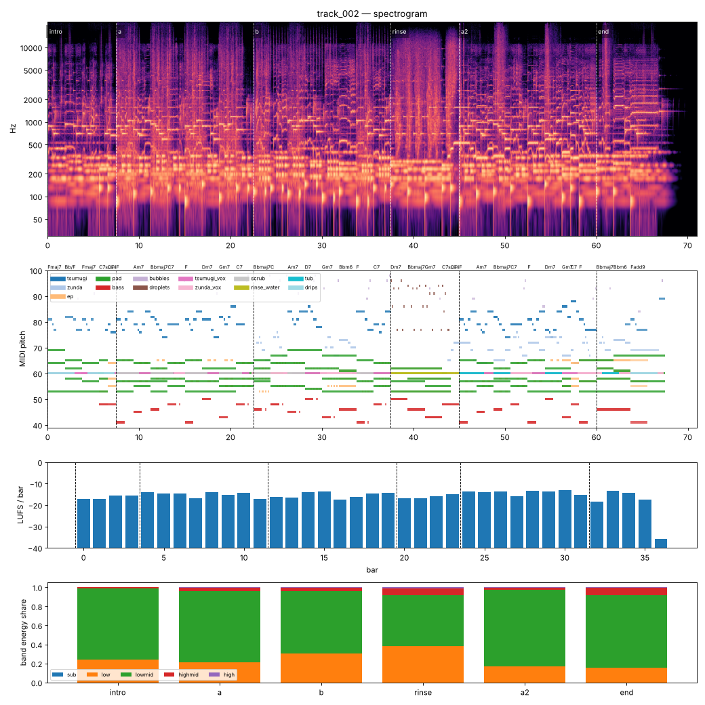

# Render report — track_002_v009

- song: `track_002` | key F major | 96 BPM | 6 sections | 71.0s
- git: `7cf1f3e558` (dirty) | spec hash `acefec130caf1193` | seed 2002

## Layer 1 — rule checks
- **INFO** `motif.ok` Motifs repeated+transformed: ['awa', 'nanoda'] (uses: {'awa': 10, 'nanoda': 3}) _melody_

## Layer 2 — acoustic diagnostics (not a quality score)

| metric | value |
|---|---|
| lufs_integrated | -15.01 |
| true_peak_dbtp | -1.04 |
| peak_dbfs | -1.05 |
| rms_dbfs | -18.03 |
| crest_db | 16.98 |
| side_to_mid_db | -11.77 |
| lr_correlation | 0.88 |
| master gain into limiter (dB) | -3.38 |
| limiter max gain reduction (dB) | 2.55 |

### Sections

| section | energy tgt | LUFS | centroid Hz | rolloff Hz | onsets/s | side/mid dB | side/mid >300 Hz | sub | low | lowmid | highmid | high |
|---|---|---|---|---|---|---|---|---|---|---|---|---|
| intro | 0.25 | -16.2 | 1391 | 2284 | 3.2 | -7.9 | -10.2 | 0.000 | 0.238 | 0.749 | 0.012 | 0.000 |
| a | 0.5 | -14.9 | 2420 | 4964 | 2.9 | -13.2 | -15.0 | 0.000 | 0.213 | 0.749 | 0.032 | 0.006 |
| b | 0.55 | -15.2 | 2181 | 4527 | 3.1 | -12.5 | -12.7 | 0.000 | 0.304 | 0.658 | 0.034 | 0.003 |
| rinse | 0.4 | -15.9 | 3011 | 6506 | 2.4 | -9.8 | -12.8 | 0.000 | 0.379 | 0.537 | 0.069 | 0.014 |
| a2 | 0.6 | -13.9 | 1920 | 3666 | 2.7 | -12.8 | -15.1 | 0.000 | 0.171 | 0.799 | 0.026 | 0.003 |
| end | 0.3 | -15.4 | 1985 | 3710 | 1.9 | -11.9 | -13.9 | 0.000 | 0.152 | 0.764 | 0.079 | 0.005 |

### Section contrast
- intro → a: ΔLUFS 1.3, Δcentroid 1029 Hz, Δonsets/s -0.3, Δwidth -5.3 dB (>300 Hz: -4.8 dB)
- a → b: ΔLUFS -0.3, Δcentroid -239 Hz, Δonsets/s 0.2, Δwidth 0.6 dB (>300 Hz: 2.3 dB)
- b → rinse: ΔLUFS -0.7, Δcentroid 829 Hz, Δonsets/s -0.7, Δwidth 2.7 dB (>300 Hz: -0.1 dB)
- rinse → a2: ΔLUFS 2.0, Δcentroid -1091 Hz, Δonsets/s 0.3, Δwidth -3.0 dB (>300 Hz: -2.4 dB)
- a2 → end: ΔLUFS -1.4, Δcentroid 65 Hz, Δonsets/s -0.8, Δwidth 0.9 dB (>300 Hz: 1.3 dB)

### Loudness by bar (LUFS)

0:-17 1:-17 2:-16 3:-15 4:-14 5:-15 6:-14 7:-17 8:-14 9:-15 10:-14 11:-17 12:-16 13:-16 14:-14 15:-14 16:-18 17:-16 18:-15 19:-14 20:-17 21:-17 22:-16 23:-15 24:-14 25:-14 26:-14 27:-16 28:-13 29:-14 30:-13 31:-15 32:-18 33:-13 34:-14 35:-17 36:-36 37:–

### Stem diagnostics
- lead_presence: lead_to_rest_1k5k_db=3.147, active_fraction=0.505
- low_end_stereo: side_to_mid_db=-14.962, lr_correlation=0.938

### Tonality
- declared: F major (rank 1); estimate: F major (0.85), A minor (0.81), C major (0.76)

## Layer 3 / 4
Critic reviews go to `critiques/`, human A/B choices to `feedback/preferences.jsonl`.

