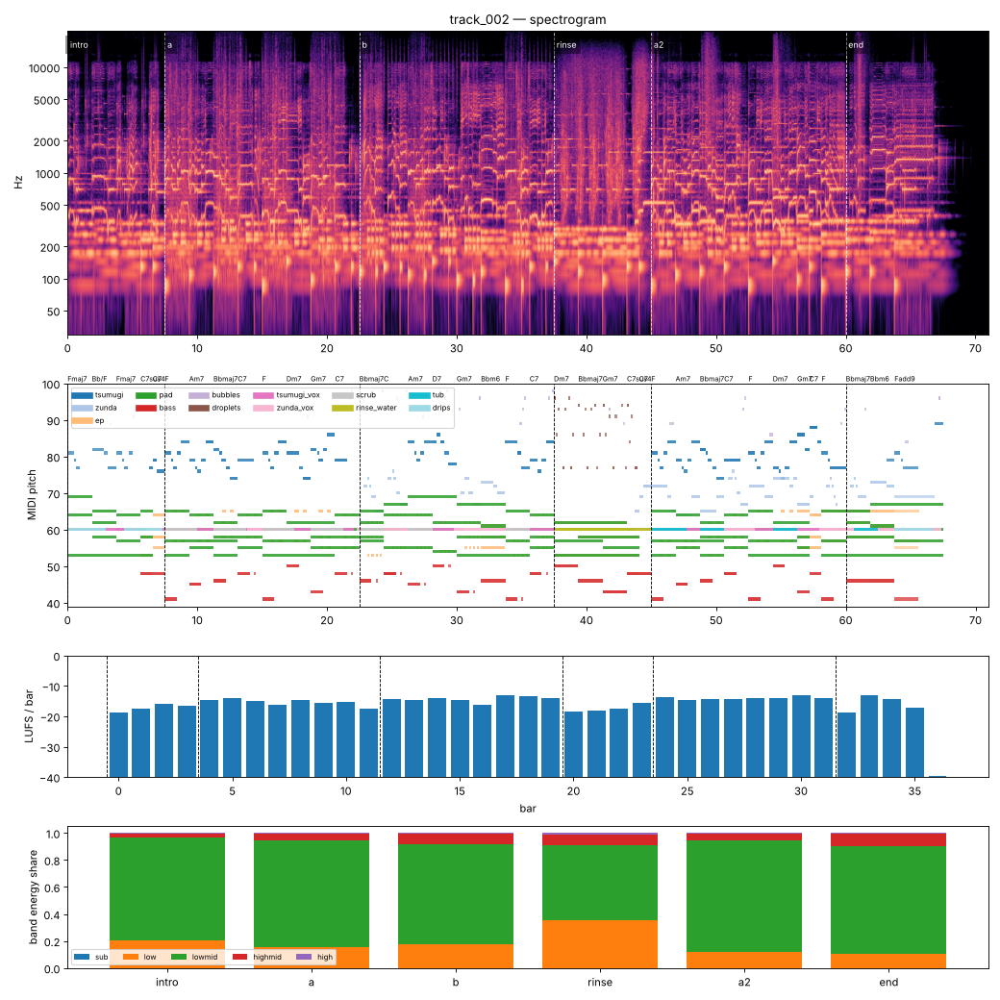

# Render report — track_002_v011

- song: `track_002` | key F major | 96 BPM | 6 sections | 71.0s
- git: `7cf1f3e558` (dirty) | spec hash `cb601bfdaec7055e` | seed 2002

## Layer 1 — rule checks
- **INFO** `motif.ok` Motifs repeated+transformed: ['awa', 'nanoda'] (uses: {'awa': 10, 'nanoda': 3}) _melody_

## Layer 2 — acoustic diagnostics (not a quality score)

| metric | value |
|---|---|
| lufs_integrated | -15.00 |
| true_peak_dbtp | -1.04 |
| peak_dbfs | -1.05 |
| rms_dbfs | -18.34 |
| crest_db | 17.29 |
| side_to_mid_db | -12.95 |
| lr_correlation | 0.90 |
| master gain into limiter (dB) | -4.87 |
| limiter max gain reduction (dB) | 1.16 |

### Sections

| section | energy tgt | LUFS | centroid Hz | rolloff Hz | onsets/s | side/mid dB | side/mid >300 Hz | sub | low | lowmid | highmid | high |
|---|---|---|---|---|---|---|---|---|---|---|---|---|
| intro | 0.25 | -16.9 | 1827 | 3468 | 3.5 | -8.5 | -10.9 | 0.000 | 0.205 | 0.763 | 0.029 | 0.002 |
| a | 0.5 | -15.2 | 2444 | 4797 | 2.8 | -14.1 | -15.9 | 0.000 | 0.158 | 0.785 | 0.052 | 0.006 |
| b | 0.55 | -14.4 | 2417 | 4739 | 3.5 | -14.2 | -14.9 | 0.000 | 0.176 | 0.738 | 0.080 | 0.005 |
| rinse | 0.4 | -17.1 | 2994 | 6418 | 2.5 | -10.0 | -13.0 | 0.000 | 0.355 | 0.555 | 0.076 | 0.014 |
| a2 | 0.6 | -13.9 | 2197 | 4239 | 2.5 | -14.0 | -16.1 | 0.000 | 0.117 | 0.830 | 0.049 | 0.003 |
| end | 0.3 | -15.2 | 2153 | 4048 | 1.7 | -13.2 | -15.1 | 0.000 | 0.105 | 0.794 | 0.097 | 0.004 |

### Section contrast
- intro → a: ΔLUFS 1.8, Δcentroid 617 Hz, Δonsets/s -0.7, Δwidth -5.6 dB (>300 Hz: -5.0 dB)
- a → b: ΔLUFS 0.8, Δcentroid -27 Hz, Δonsets/s 0.7, Δwidth -0.1 dB (>300 Hz: 0.9 dB)
- b → rinse: ΔLUFS -2.8, Δcentroid 577 Hz, Δonsets/s -0.9, Δwidth 4.2 dB (>300 Hz: 1.9 dB)
- rinse → a2: ΔLUFS 3.2, Δcentroid -797 Hz, Δonsets/s -0.1, Δwidth -4.0 dB (>300 Hz: -3.1 dB)
- a2 → end: ΔLUFS -1.3, Δcentroid -44 Hz, Δonsets/s -0.7, Δwidth 0.8 dB (>300 Hz: 1.0 dB)

### Loudness by bar (LUFS)

0:-19 1:-17 2:-16 3:-16 4:-15 5:-14 6:-15 7:-16 8:-15 9:-15 10:-15 11:-18 12:-14 13:-15 14:-14 15:-14 16:-16 17:-13 18:-13 19:-14 20:-18 21:-18 22:-17 23:-16 24:-14 25:-14 26:-14 27:-14 28:-14 29:-14 30:-13 31:-14 32:-19 33:-13 34:-14 35:-17 36:-40 37:–

### Stem diagnostics
- lead_presence: lead_to_rest_1k5k_db=22.267, active_fraction=0.647
- low_end_stereo: side_to_mid_db=-14.968, lr_correlation=0.938

### Tonality
- declared: F major (rank 1); estimate: F major (0.85), A minor (0.82), C major (0.75)

## Layer 3 / 4
Critic reviews go to `critiques/`, human A/B choices to `feedback/preferences.jsonl`.

